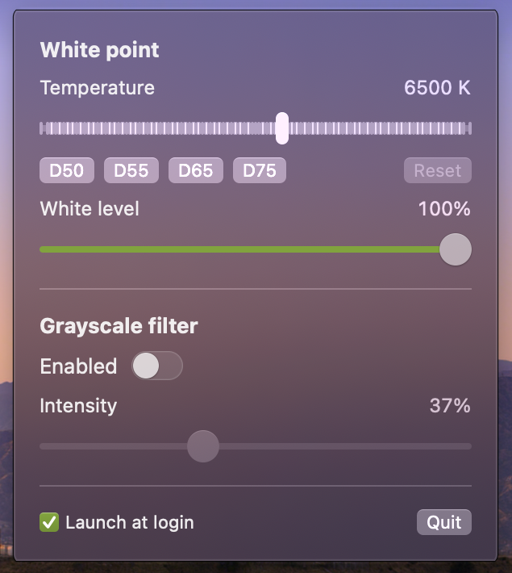

# WhitePointBar

**White point and grayscale control in one macOS menu bar app, including a
grayscale intensity slider.**

<p align="center">
  
</p>

Existing tools split this up. Night Shift, f.lux and Shifty handle colour
temperature. Grayscale menu bar apps such as Grayscale Mode only toggle the
filter on and off. WhitePointBar puts both in one popover, and it lets you set
grayscale *partially*: anywhere from 0% to 100%, not just on or off.

- **Grayscale intensity** – a slider for how strong the system grayscale filter
  is, plus an on/off switch. It drives the same setting as System Settings →
  Accessibility → Display → Color Filters, without digging through Settings.
- **White point** – target colour temperature from 2000 to 10000 K, both warmer
  *and* cooler than D65 (Night Shift and f.lux only go warmer). Presets for
  D50/D55/D65/D75.
- **White level** – dims peak white (30–100%) without touching backlight
  brightness.

Requires macOS 13+. Built with SwiftUI `MenuBarExtra`, no dependencies.

> **Status: early.** The grayscale controls use Apple's undocumented color-filter
> settings and may need adjusting on some macOS versions. See
> [troubleshooting](#if-something-doesnt-take-effect).

## Build & run

```sh
scripts/build-app.sh            # → build/WhitePointBar.app
scripts/build-app.sh --install  # copy to ~/Applications and launch
swift run                       # quick dev run (no .app bundle; login item won't work)
```

Requires Xcode or the Command Line Tools (`xcode-select --install`).

## How it works

**White point** scales each display's gamma table (`CGSetDisplayTransferByTable`)
on top of the ColorSync baseline, so calibrated monitors keep their calibration.
6500 K at 100% = untouched. Quartz discards gamma tables when the process exits,
so the effect lasts only while the app is running (enable *Launch at login*). It
re-asserts itself on wake / display changes and every 10 s. Night Shift or other
gamma tools (f.lux, Lunar, etc.) will fight with it — use one at a time.

**Grayscale** uses private MediaAccessibility symbols resolved at runtime
(`MADisplayFilterPrefSetCategoryEnabled`, `MADisplayFilterPrefSetType`) and
falls back to writing `com.apple.mediaaccessibility` prefs. Intensity is written
to that prefs domain. Apple doesn't document any of this, so it may need a
tweak per macOS version.

## If something doesn't take effect

```sh
build/WhitePointBar.app/Contents/MacOS/WhitePointBar --probe  # which symbols resolved, current prefs
scripts/probe.sh                                              # exported symbols + prefs
scripts/probe.sh --diff                                       # find the exact intensity key
defaults write local.mike.WhitePointBar GrayscaleIntensityKey '<key from diff>'
```
